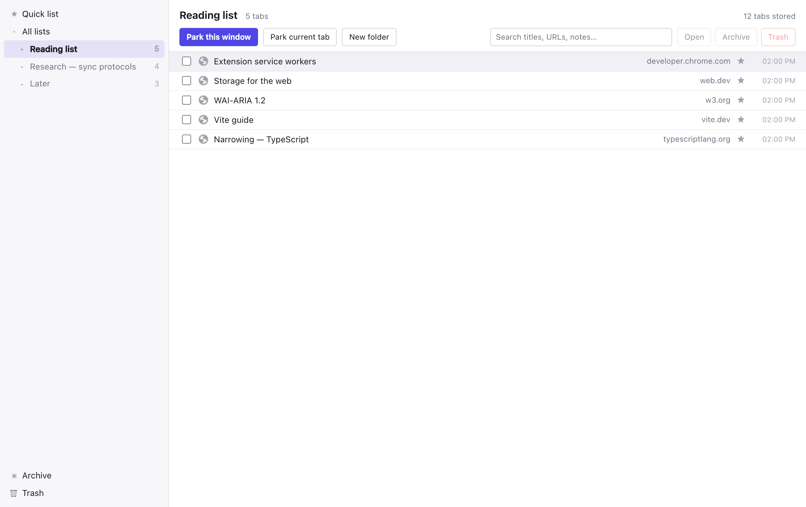
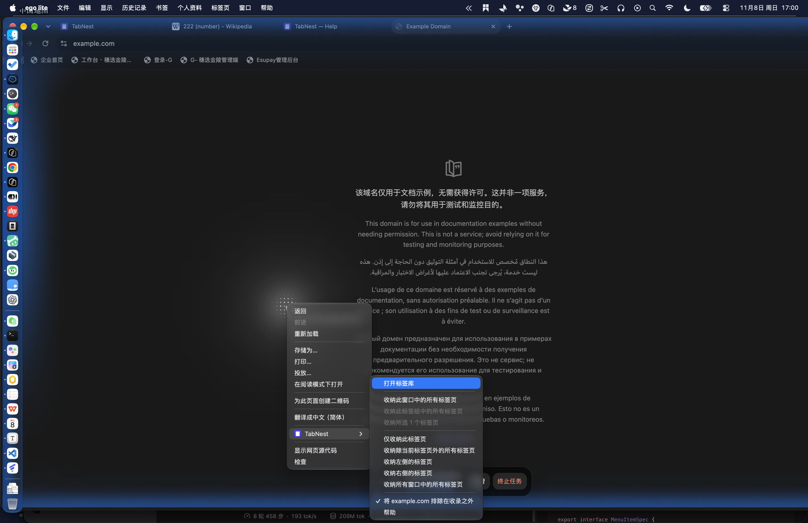
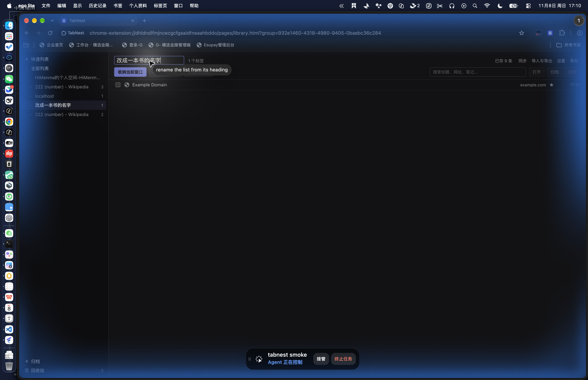

# TabNest

**English** · [简体中文](README.zh-CN.md)

A tab manager for Chrome: park your open tabs into lists, organise the lists into
folders and groups, find anything by typing, and restore it later — with **your
choice of sync backend** and end-to-end encryption.



## Why another tab manager

Adoption of any tab manager is gated by where it keeps your data. Most give you a
choice between one vendor's cloud and nothing at all. TabNest treats storage as a
pluggable backend:

- **Chrome sync storage** — zero setup, inside your own Google account.
- **WebDAV** — Nextcloud, Synology, 坚果云, or any folder on a server you own.
- **Custom HTTP endpoint** — seven routes; a ~100-line reference server ships in
  [`server/`](server/) and runs on a Cloudflare Worker or a spare machine.
- **GitHub Gist** — a private gist, with a token you provide.

Each device only ever writes its own key prefix, so no backend needs locking,
compare-and-swap, or a database: a plain folder is enough. Conflicts resolve to
the newest record, and a deletion is remembered for 90 days so an offline device
cannot resurrect it.

Payloads for every external backend are sealed with AES-GCM under a key derived
from your passphrase (PBKDF2-SHA256); each chunk's position is bound into the
AAD, so a chunk cannot be moved, duplicated or reordered without failing to
decrypt. The storage operator sees sizes and timestamps, not titles or URLs.

## Features

**Parking.** Eight scopes — this window, this tab group, your highlighted tabs,
the current tab, everything except it, tabs to the left, tabs to the right, all
windows — reachable from the toolbar menu, the popup, a right-click, or a
keyboard command. The tabs close; the records stay.



**Organising.** Folders, window groups and nested Chrome tab groups, plus a quick
list, an archive and a trash. Rename a list from its heading or its sidebar entry
(click the name, or F2). Delete one from either place and it goes to the trash
with its contents; restoring puts it back where it came from.



**Finding.** Search across titles, URLs, hosts and notes, over a virtualised list
that stays responsive with thousands of records. Multi-select, drag and drop,
inline editing, notes and star ratings.

**Moving data.** Import a URL list, JSON, your bookmarks, or your Chrome reading
list. Export a versioned JSON file or a self-contained HTML page — no server
involved.

**Small things that matter.** Per-site "never park this host" switch in the menu;
a recent-lists submenu that deep-links into the library; a help page that reads
your live shortcuts; light and dark themes; English and Chinese.

## Sync, in more detail

| Backend                 | Setup                                           | Capacity   | Encryption                    |
| ----------------------- | ----------------------------------------------- | ---------- | ----------------------------- |
| `chrome-sync` (default) | none — your Chrome profile                      | ~100 KB    | off (already in your account) |
| `webdav`                | URL + credentials (Nextcloud, Synology, 坚果云) | your quota | on                            |
| `http`                  | any endpoint implementing seven routes          | yours      | on                            |
| `gist`                  | a GitHub token                                  | 1 MB/file  | on                            |

`chrome.storage.sync` holds about 100 KB — roughly 1500–2500 tabs. Past that the
engine pauses and tells you why; it never truncates silently. For bigger
libraries, point it at WebDAV or your own endpoint.

The protocol, the conflict rules and the quota guard are in
[docs/sync-design.md](docs/sync-design.md); the endpoint contract, with curl
examples and a Cloudflare Worker, is in [docs/backends.md](docs/backends.md).

## Install (unpacked)

```bash
pnpm install
pnpm build          # -> dist/
```

Open `chrome://extensions`, enable Developer mode, choose **Load unpacked**, and
pick `dist/`. If you change the code, click the reload button on the extension
card.

## Working on it

| Command          | What it does                                                                                  |
| ---------------- | --------------------------------------------------------------------------------------------- |
| `pnpm dev`       | rebuild on change (reload the extension to pick it up)                                        |
| `pnpm typecheck` | `tsc --noEmit`                                                                                |
| `pnpm lint`      | Biome, formatting and lint in one pass                                                        |
| `pnpm test`      | 174 unit tests: data layer, sync codec, crypto, conflict matrix…                              |
| `pnpm smoke`     | loads `dist/` in Chromium: parking, rename, delete, 5 000-record scale, `chrome.storage.sync` |
| `pnpm e2e:sync`  | two Chromium profiles syncing through the reference server                                    |
| `pnpm a11y`      | axe-core over every surface; zero violations is the bar                                       |
| `pnpm shots`     | regenerate `docs/screenshots` from the real build                                             |
| `pnpm zip`       | store-ready archive                                                                           |

`pnpm smoke` and `pnpm e2e:sync` need a Playwright Chromium
(`npx playwright install chromium`).

## Layout

```
pages/            HTML entry points (library, popup, options, sync, import, help)
src/background/   service worker: capture, routing, action menu, sync engine
src/data/         IndexedDB schema, repository, URL canonicalisation
src/ui/           React surfaces, shared components, design tokens, i18n
scripts/          build, manifest, icons, smoke, e2e, a11y, screenshots
server/           reference sync server (Cloudflare Worker + Node)
docs/             architecture, sync protocol, backend contract, privacy, listing
test/             unit (vitest) and end-to-end (playwright)
```

A few design notes worth knowing before changing things:

- The service worker is the only writer; pages read through it and refresh on a
  `data-changed` broadcast.
- Every mutation appends to a journal inside the same transaction, so the sync
  engine never has to diff snapshots.
- A tab's id is `base64url(SHA-256(canonicalUrl))` sliced to 22 characters, which
  makes dedupe and cross-device convergence fall out of the address itself.

More in [docs/architecture.md](docs/architecture.md).

## Permissions, and why

| Permission                              | Reason                                                         |
| --------------------------------------- | -------------------------------------------------------------- |
| `tabs`                                  | reading the URLs and titles of the tabs you park — the product |
| `storage`, `unlimitedStorage`           | the library, and `chrome.storage.sync` when chosen             |
| `activeTab`, `scripting`                | a link's label, only when you use the context menu             |
| `contextMenus`, `commands`, `alarms`    | the menu, shortcuts, scheduled maintenance                     |
| `favicon`                               | local site icons, so no third party learns your URLs           |
| `tabGroups`, `bookmarks`, `readingList` | **optional**, requested when you enable those features         |
| `https://*/*`, `http://*/*`             | **optional**, requested for a sync endpoint you type in        |

No analytics, no account, no remote code. [docs/privacy.md](docs/privacy.md)
describes every byte that leaves the machine.

## Documentation

- [architecture](docs/architecture.md) — data model, capture rules, decisions
- [sync design](docs/sync-design.md) — protocol, conflicts, quotas, encryption
- [backend contract](docs/backends.md) — the seven routes, and how to serve them
- [migration](docs/migration.md) — bringing a library over from another tool
- [privacy](docs/privacy.md) · [policy](docs/privacy-policy.md)
- [roadmap](docs/roadmap.md) · [review checklist](docs/review-checklist.md) ·
  [store listing](docs/store-listing.md)
- [changelog](CHANGELOG.md)

## Licence

MIT — see [LICENSE](LICENSE).

TabNest is an independent, clean-room implementation. It contains no code, assets
or UI copy from any other extension; [NOTICE.md](NOTICE.md) records the
provenance, and the only import path from another tool is a file you already own.
