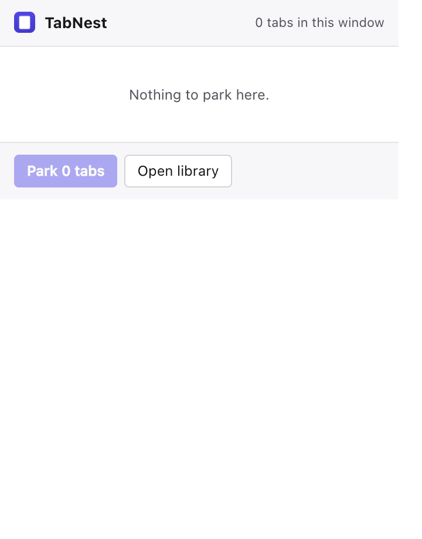
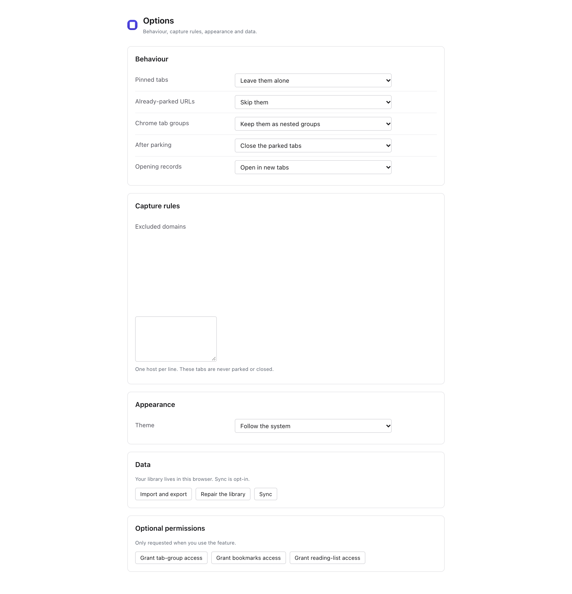
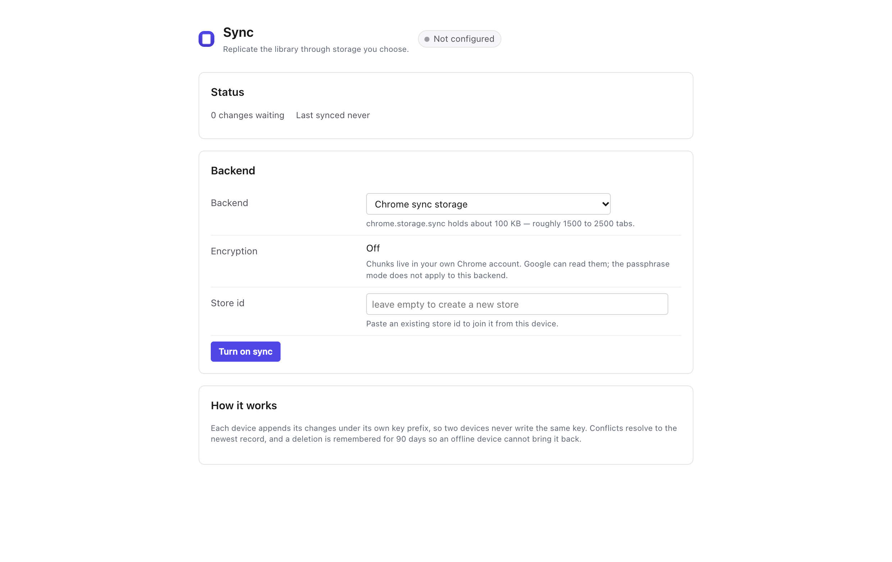
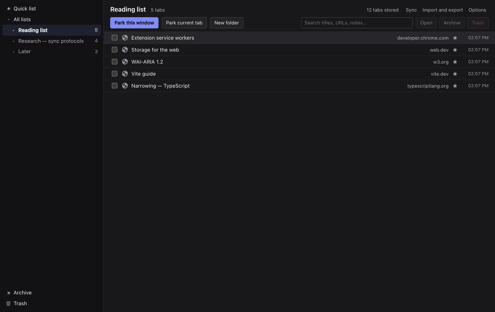

# TabNest

A Chrome tab manager: park your open tabs into lists, organise them into folders
and groups, find them again by search, and restore them later — with **your
choice of sync backend** and end-to-end encryption.


## What it does

- **Park** a whole window, a tab group, the current tab, everything except it,
  everything left or right of it, all windows, or a hand-picked selection. The
  tabs close; the records stay.
- **Organise** with folders, window groups and nested Chrome tab groups, plus a
  quick list, an archive and a trash.
- **Find** by typing: titles, URLs, hosts and notes, over a virtualised list that
  stays smooth at thousands of records.
- **Annotate** with notes and star ratings; rename records inline.
- **Restore** a single tab, a group, or a whole window strip.
- **Import** URL lists, JSON, bookmarks or your reading list; **export** to JSON
  or a self-contained HTML page.

## Sync you control

| Backend                 | Setup                                           | Capacity         | Encryption |
| ----------------------- | ----------------------------------------------- | ---------------- | ---------- |
| `chrome-sync` (default) | none — your Chrome profile                      | ~100 KB          | optional   |
| `webdav`                | URL + credentials (Nextcloud, Synology, 坚果云) | your quota       | on         |
| `http`                  | any endpoint implementing seven routes          | whatever you run | on         |
| `gist`                  | a GitHub token                                  | 1 MB per file    | on         |

Each device appends chunks under its own key prefix, so no backend needs
compare-and-swap, locking, or a database: a WebDAV folder is enough. Readers merge
with last-write-wins per record, and equal timestamps converge by comparing the
two serialisations, so devices cannot swap records forever.

Payloads for external backends are sealed with AES-GCM using a PBKDF2-derived key;
the chunk's position is bound into the AAD, so a chunk cannot be moved, duplicated
or reordered without failing to decrypt. The store operator sees sizes and
timestamps, not titles or URLs.

`server/` contains the reference implementation — about a hundred lines — for
Cloudflare Workers or a spare machine, and `docs/backends.md` is the whole
contract.

## Screenshots

|                                               |                                                   |
| --------------------------------------------- | ------------------------------------------------- |
|  |  |
|    |      |

## Install (unpacked)

```bash
pnpm install
pnpm build            # -> dist/
```

Open `chrome://extensions`, enable Developer mode, "Load unpacked", choose `dist/`.

## Develop

```bash
pnpm dev          # rebuild on change (reload the extension to pick it up)
pnpm typecheck    # tsc --noEmit
pnpm lint         # biome check
pnpm test         # vitest — 142 cases
pnpm smoke        # loads dist/ in Chromium: parking, scale, chrome.storage.sync
pnpm e2e:sync     # two Chromium profiles syncing through the reference server
pnpm a11y         # axe-core over every surface
pnpm shots        # regenerate docs/screenshots
pnpm zip          # store-ready archive
```

## Layout

```
pages/            HTML entry points (library, popup, options, sync, import)
src/background/   service worker: capture, routing, sync engine and backends
src/data/         IndexedDB schema, repository, URL canonicalisation
src/ui/           React surfaces, shared components, design tokens, i18n
scripts/          build pipeline, manifest, icons, smoke, e2e, a11y, screenshots
server/           reference sync server (Worker + Node)
docs/             architecture, sync protocol, backend contract, privacy, listing
test/             unit (vitest) and end-to-end (playwright)
```

## Permissions, and why

| Permission                              | Reason                                                              |
| --------------------------------------- | ------------------------------------------------------------------- |
| `tabs`                                  | reading the URLs and titles of the tabs you park — the core feature |
| `storage`, `unlimitedStorage`           | the library, and `chrome.storage.sync` when chosen                  |
| `activeTab`, `scripting`                | a link's label, only when you invoke the context menu               |
| `contextMenus`, `commands`, `alarms`    | menus, shortcuts, scheduled maintenance                             |
| `favicon`                               | local site icons, so no third party sees your URLs                  |
| `tabGroups`, `bookmarks`, `readingList` | **optional**, requested when you enable them                        |
| `https://*/*`, `http://*/*`             | **optional**, requested for a sync endpoint you type in             |

No analytics, no accounts, no remote code.

## Documentation

- [architecture](docs/architecture.md) — data model, capture rules, decisions
- [sync design](docs/sync-design.md) — the protocol, conflicts, quotas, encryption
- [backend contract](docs/backends.md) — the seven routes and how to serve them
- [migration](docs/migration.md) — bringing a library from another tool
- [privacy](docs/privacy.md) · [policy](docs/privacy-policy.md)
- [roadmap](docs/roadmap.md) · [review checklist](docs/review-checklist.md) ·
  [store listing](docs/store-listing.md)
- [changelog](CHANGELOG.md)

## Licence

MIT — see `LICENSE`. `NOTICE.md` documents the clean-room provenance: no code,
assets or copy from any other extension.
