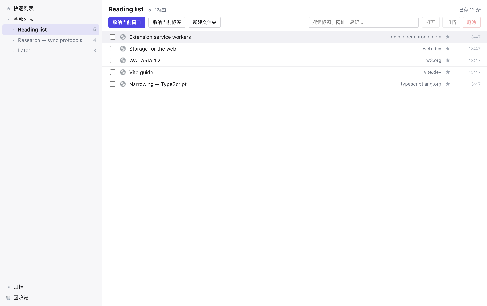
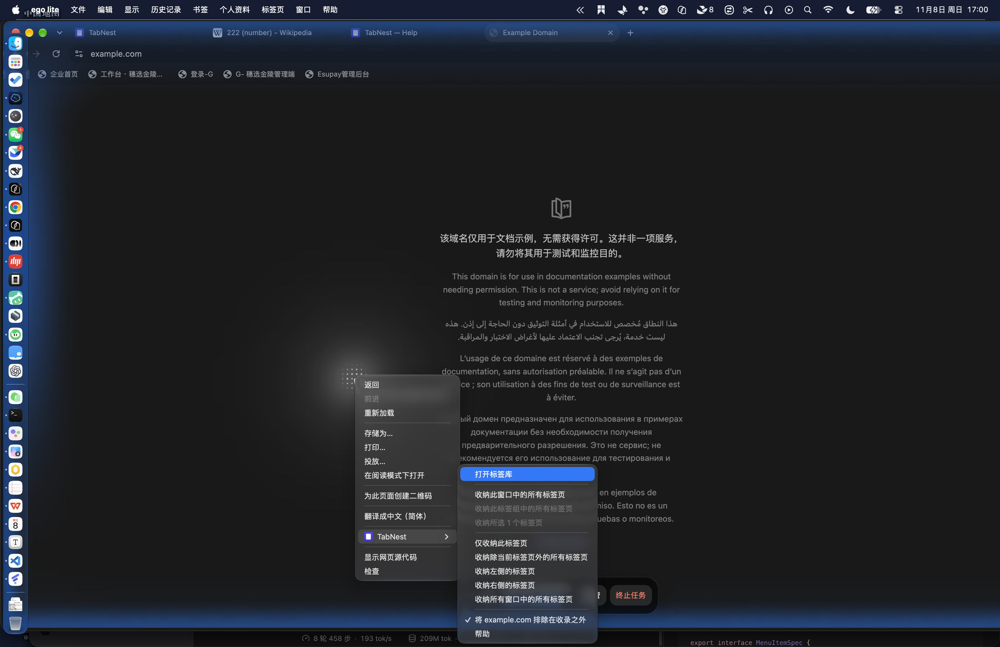
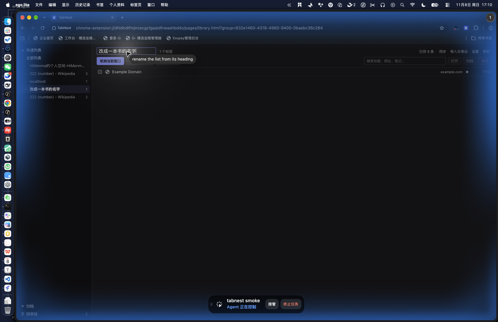

# TabNest

[English](README.md) · **简体中文**

一个 Chrome 标签页管理器：把开着的标签收纳成列表，用文件夹和分组整理，靠搜索找回来，之后再恢复——**同步后端由你选**，并支持端到端加密。



## 为什么再造一个标签管理器

用不用一个标签管理器，往往取决于它把你的数据放在哪里。多数产品只给你两个选项：某个厂商的云，或者什么都没有。TabNest 把存储做成可插拔的后端：

- **Chrome 同步存储** —— 零配置，数据在你自己 Google 账户里。
- **WebDAV** —— Nextcloud、群晖、坚果云，或你自己服务器上的任意目录。
- **自定义 HTTP 端点** —— 七条路由；[`server/`](server/) 里附约 100 行的参考实现，可跑在 Cloudflare Worker 或一台闲置机器上。
- **GitHub Gist** —— 用你自己的令牌存进私有 gist。

每台设备只往自己的键前缀写，所以任何后端都不需要锁、不需要 CAS、不需要数据库：一个普通文件夹就够。冲突按最新记录取胜；删除会保留 90 天，避免离线设备把它复活。

外部后端的载荷一律用 AES-GCM 加密，密钥由你的口令派生（PBKDF2-SHA256）；每个分块的位置被绑进 AAD，移动、复制或重排都会解密失败。存储方只看得到大小和时间戳，看不到标题和网址。

## 功能

**收纳。** 八种范围——当前窗口、当前标签组、你高选的标签页、仅当前标签、除当前外、左侧、右侧、所有窗口——可以从工具栏菜单、弹窗、右键或快捷键触发。标签关闭，记录留下。



**整理。** 文件夹、窗口组、嵌套的 Chrome 标签组，外加快速列表、归档与回收站。列表名可以在标题或侧栏上改（点名字，或按 F2）；两处都能删除，删掉的列表连同内容进回收站，恢复时回到原来的位置。



**查找。** 搜索标题、网址、主机名和笔记；虚拟滚动的列表在几千条记录下依然跟手。支持多选、拖拽、就地编辑、笔记和星级评分。

**搬数据。** 导入网址列表、JSON、书签或 Chrome 阅读清单；导出带版本号的 JSON，或一个自包含的 HTML 页面——不经过任何服务器。

**一些小事。** 菜单里可以一键把当前站点排除在收录之外；「最近的分组」子菜单直接跳到对应列表；帮助页读取你真实的快捷键；浅色/深色主题；中英双语。

## 同步细节

| 后端                  | 需要配置                               | 容量         | 加密                 |
| --------------------- | -------------------------------------- | ------------ | -------------------- |
| `chrome-sync`（默认） | 无需配置——用你的 Chrome 配置           | 约 100 KB    | 关（本就在你账户里） |
| `webdav`              | 地址 + 凭据（Nextcloud、群晖、坚果云） | 你的网盘额度 | 开启                 |
| `http`                | 任意实现七条路由的端点                 | 取决于你     | 开启                 |
| `gist`                | 一个 GitHub 令牌                       | 单文件 1 MB  | 开启                 |

`chrome.storage.sync` 只有约 100 KB，大致相当于 1500–2500 个标签。超出时引擎会暂停并说明原因，**绝不静默截断**。库更大就指向 WebDAV 或自建端点。

协议、冲突规则与配额守卫见 [docs/sync-design.md](docs/sync-design.md)；端点契约、curl 示例和 Cloudflare Worker 见 [docs/backends.md](docs/backends.md)。

## 安装（未打包）

```bash
pnpm install
pnpm build          # -> dist/
```

打开 `chrome://extensions`，开启开发者模式，点「加载未打包的扩展程序」，选 `dist/`。改了代码后，点扩展卡片上的刷新按钮即可。

## 开发

| 命令             | 作用                                                                             |
| ---------------- | -------------------------------------------------------------------------------- |
| `pnpm dev`       | 改动后自动重建（需手动刷新扩展）                                                 |
| `pnpm typecheck` | `tsc --noEmit`                                                                   |
| `pnpm lint`      | Biome，格式与静态检查一次过                                                      |
| `pnpm test`      | 174 条单测：数据层、同步编码、加密、冲突矩阵……                                   |
| `pnpm smoke`     | 在 Chromium 里加载 `dist/`：收纳、改名、删除、5000 条规模、`chrome.storage.sync` |
| `pnpm e2e:sync`  | 两个 Chromium 配置经参考服务器同步                                               |
| `pnpm a11y`      | axe-core 扫全部界面，零违规是底线                                                |
| `pnpm shots`     | 用真实构建重新生成 `docs/screenshots`                                            |
| `pnpm zip`       | 生成商店发布包                                                                   |

`pnpm smoke` 与 `pnpm e2e:sync` 需要 Playwright 的 Chromium（`npx playwright install chromium`）。

## 目录结构

```
pages/            HTML 入口（库、弹窗、设置、同步、导入导出、帮助）
src/background/   Service Worker：收纳、路由、工具栏菜单、同步引擎
src/data/         IndexedDB 结构、仓储层、URL 规范化
src/ui/           React 界面、共享组件、设计变量、i18n
scripts/          构建、manifest、图标、smoke、e2e、a11y、截图
server/           参考同步服务器（Cloudflare Worker + Node）
docs/             架构、同步协议、后端契约、隐私、上架文案
test/             单测（vitest）与端到端（playwright）
```

动手前值得知道的几个约定：

- Service Worker 是唯一写入方；页面经它读写，并通过 `data-changed` 广播刷新。
- 每次改动都在同一个事务里追加一条日志，所以同步引擎不需要做快照差分。
- 标签页的 id 是 `base64url(SHA-256(规范化网址))` 截到 22 个字符——去重和跨设备收敛直接从地址本身推出来。

更多见 [docs/architecture.md](docs/architecture.md)。

## 权限与理由

| 权限                                    | 用途                                           |
| --------------------------------------- | ---------------------------------------------- |
| `tabs`                                  | 读取你要收纳的标签页网址与标题——这就是产品本身 |
| `storage`、`unlimitedStorage`           | 标签库；选择 Chrome 同步时也用它               |
| `activeTab`、`scripting`                | 仅在你用右键菜单时读取链接文字                 |
| `contextMenus`、`commands`、`alarms`    | 菜单、快捷键、定时维护                         |
| `favicon`                               | 本地站点图标，第三方拿不到你的网址             |
| `tabGroups`、`bookmarks`、`readingList` | **可选**，你开启对应功能时才申请               |
| `https://*/*`、`http://*/*`             | **可选**，你填入同步端点时才申请               |

没有统计、没有账号、没有远程代码。离开本机的每一个字节都写在 [docs/privacy.md](docs/privacy.md) 里。

## 文档

- [架构](docs/architecture.md) —— 数据模型、收纳规则、设计决策
- [同步设计](docs/sync-design.md) —— 协议、冲突、配额、加密
- [后端契约](docs/backends.md) —— 七条路由，以及怎么实现它
- [迁移](docs/migration.md) —— 从别的工具把标签库搬过来
- [隐私](docs/privacy.md) · [隐私政策](docs/privacy-policy.md)
- [路线图](docs/roadmap.md) · [发布前检查清单](docs/review-checklist.md) · [商店文案](docs/store-listing.md)
- [更新日志](CHANGELOG.md)

## 许可

MIT —— 见 [LICENSE](LICENSE)。

TabNest 是独立实现，不含任何其他扩展的代码、素材或界面文案；[NOTICE.md](NOTICE.md) 记录了来源说明，从别的工具迁移的唯一入口是你自己导出的本地文件。
